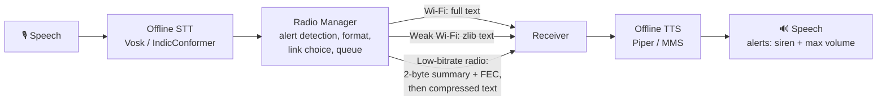

# iTantra

**Indian Multilingual TTS & STT Aided Neural Transceiver Radio Access for Low-Bitrate Links**

[](https://github.com/tensorbytes0202/Agni_team_Itantra/actions/workflows/main.yml)

iTantra lets people talk over links that are too weak for voice. The sender speaks in an Indian language,
the speech is turned into text **on the device**, the text travels over Wi-Fi or a low-bitrate radio link, and
the receiver hears it as speech again. Everything runs **offline** with open-source models: no internet,
no cloud API.

Built by **Team Agni** for Smart India Hackathon problem statement **SIH PS 26173**. This repository is the
laptop prototype; the Android app follows the same design.

---

## Contents

- [Why](#why)
- [How it works](#how-it-works)
- [Features](#features)
- [Languages](#languages)
- [Measured results](#measured-results)
- [What is real and what is emulated](#what-is-real-and-what-is-emulated)
- [Repository layout](#repository-layout)
- [Setup](#setup)
- [Run](#run)
- [Tests](#tests)
- [Roadmap](#roadmap)
- [Licenses](#licenses)

---

## Why

Voice is the most inclusive way to send an alert: it works for people who cannot read or type. But raw
audio is heavy. A 3-second voice note is about **96 KB** of 16 kHz audio, while the same sentence as text
is about **25 bytes**, and iTantra's emergency summary is **2 bytes**.

That difference matters where networks are weak or gone: disasters, remote and hilly areas, search and
rescue, field operations, and infrastructure failures.

## How it works



1. **Capture.** Push-to-talk, or hands-free mode that sends each sentence after a 0.8 s pause.
2. **Speech to text.** Runs locally. Only one language model is kept in memory at a time.
3. **Radio Manager.** Detects alerts (keywords in 10 languages), probes every link for packet loss and
   round-trip time, picks the best healthy link and shapes the message to fit it.
4. **Delivery.** Every packet is CRC-checked and acknowledged, with retries. If a link fails, the message
   fails over to the next one. If no link is available, it waits in a queue on disk and is sent, alerts
   first, as soon as a link comes back.
5. **Text to speech.** The receiver picks the voice from the script of the text and speaks it. Alerts
   play a siren and then the message at full volume, and cannot be interrupted.

## Features

| Area | What it does |
|---|---|
| Offline STT | Vosk (English, Hindi) and AI4Bharat IndicConformer INT8 through sherpa-onnx (7 Indic languages) |
| Offline TTS | Piper voices (English, Hindi, Malayalam) and Meta MMS voices (7 more languages) through sherpa-onnx |
| Small footprint | Models ship as LZMA language packs and are unzipped only when a language is chosen |
| Link selection | Wi-Fi preferred, then Bluetooth (once built), then low-bitrate radio; health from live PER/RTT probes; hysteresis stops flapping |
| Link-adaptive format | Full text on good Wi-Fi, zlib on weak Wi-Fi, and a 2-byte summary with Hamming(7,4) FEC on the radio |
| Reliability | CRC32 (full header) or CRC16 (5-byte compact header), ACK + retry, duplicate filtering, failover |
| Store and forward | Unsent messages are kept on disk, survive a restart, and go out alerts-first when a link returns |
| Alerts | Keyword detection in 10 languages; siren + full-volume, non-interruptible playback |
| Location | Optional GPS position: 8 bytes on Wi-Fi, 5 bytes (about 2 m error) on the radio; receiver shows distance and direction |
| Wi-Fi connect | Scans nearby networks (strongest first), joins open ones in one click and secured ones with a password |
| Discovery | Sender and receiver find each other on the network automatically, or by typed IP |
| Interfaces | Tkinter desktop app, Streamlit connection UI, terminal nodes |

## Languages

| Language | STT | TTS |
|---|---|---|
| English | Vosk small | Piper |
| Hindi | Vosk small | Piper |
| Malayalam | IndicConformer INT8 | Piper |
| Gujarati, Marathi, Kannada, Tamil, Telugu, Bengali | IndicConformer INT8 | MMS |
| Odia | **not available yet** | MMS |

STT covers 9 of the 10 languages today; TTS covers all 10.

## Measured results

All numbers were measured on a laptop CPU.

| What | Result |
|---|---|
| STT, one English test sentence | 113 ms, RTF 0.03 |
| TTS, Hindi Piper voice | RTF about 0.15, about 90 MB RAM, 0.9 s load |
| IndicConformer INT8 pack size | 140 MB → about 76 MB zipped (unzip about 5 s) |
| Alert summary on the radio link | 2 bytes (11 bytes with location) after FEC |
| Failover when Wi-Fi drops | about 4 s to switch to the radio link |
| Return to Wi-Fi when it recovers | about 10–16 s (needs 3 healthy checks in a row) |

Word error rate across all languages has not been measured yet.

## What is real and what is emulated

| Part | Status |
|---|---|
| Wi-Fi transmission (UDP), packets, CRC, ACK, failover, queue | **Real** |
| STT (9 languages) and TTS | **Real**, offline (Piper voices tested; MMS voices not fully verified yet) |
| Wi-Fi scan / connect, discovery, signal readout | **Real** (Windows `netsh`, Linux `nmcli`) |
| Low-bitrate radio link (600 bps, loss, bit errors, frequencies) | **Emulated** in software, behind the same interface a LoRa module will use |
| Channel conditions (interference, jamming) | **Emulated** |
| Bluetooth link | Not built yet |
| Android app | Not built yet; this repo is the laptop prototype |

## Repository layout

```text
.
├── README.md                     this file
├── .github/workflows/main.yml    CI: runs the full test suite on Python 3.10 and 3.11
└── itantra-main/                 the project (run every command from here)
    ├── requirements.txt
    ├── TEST_PLAN.md              manual test checklist for demos
    ├── record.py                 record a 5 s, 16 kHz test WAV
    ├── itantra_link/             transmission layer + apps
    │   ├── radio_manager.py      link choice, failover, ACK/retry, queue, adaptive format
    │   ├── transports.py         Wi-Fi UDP + emulated low-bitrate radio
    │   ├── packet.py             packet format, CRC, compact header
    │   ├── summary.py            alert detection (10 languages) + 2-byte summary with FEC
    │   ├── location.py           compact GPS encoding, distance and direction
    │   ├── channel_lab.py        auto-discovery + emulated channel conditions
    │   ├── wifi_scan.py          scan / connect / current signal
    │   ├── app.py                desktop app (Tkinter): talk, listen, links, channel lab
    │   ├── streamlit_ui.py       connection UI (Streamlit)
    │   ├── node.py, voice_node.py  terminal nodes (text / microphone)
    │   ├── speaker.py            receiver TTS worker with alert priority
    │   └── tests/
    └── itantra_ai/               speech + semantic pipeline
        ├── stt/                  STT engine (Vosk + IndicConformer)
        ├── tts/                  TTS engine, player, model downloader
        ├── model_packs.py        LZMA language packs: build / status / prune / extract
        ├── semantic/, priority/, encoder/, compression/, context/, reliability/, transport/, channel/
        │                         V1 semantic codec: fields → priorities → bit-level codebook → Hamming FEC
        ├── app.py, receiver_app.py   V1 Streamlit demo of the semantic codec
        └── tests/
```

## Setup

Python 3.10 or 3.11. Commands below are for Windows; on Linux use `source venv/bin/activate`.

```powershell
cd itantra-main
python -m venv venv
venv\Scripts\activate
python -m pip install -r requirements.txt
chcp 65001        # lets the console print Indic scripts
```

### Models

Models are not in git because they are large (about 900 MB in total). They live as LZMA zips in
`itantra-main/language_packs/` (`stt-<lang>.zip`, `tts-<lang>.zip`) and unzip automatically when a
language is selected. Get the zips from the team, or download the originals:

| Part | Languages | Where to get it | Put it in |
|---|---|---|---|
| STT Vosk | en, hi | [alphacephei.com/vosk/models](https://alphacephei.com/vosk/models): `vosk-model-small-en-us-0.15`, `vosk-model-small-hi-0.22` | `itantra_ai/stt/models/` |
| STT IndicConformer INT8 | gu, mr, kn, ml, ta, te, bn | Hugging Face `mobilebytesensei/betterflow-indicconformer-ctc` | `itantra_ai/stt/models/indicconformer/<lang>/` |
| TTS | all | `python -m itantra_ai.tts.download_models en hi ml` (Piper) and `... ta te kn gu mr bn or` (MMS) | automatic |

Then pack them:

```powershell
python -m itantra_ai.model_packs build     # zip every unzipped model
python -m itantra_ai.model_packs prune     # delete unzipped copies that have a verified zip
python -m itantra_ai.model_packs status    # what is zipped / unzipped, and sizes
```

## Run

All commands run from `itantra-main/`.

**Desktop app (best for demos).** One window per role. On the same Wi-Fi the two find each other
automatically; otherwise add `--peer-ip <other laptop's IP>`.

```powershell
python -m itantra_link.app --role sender   --lat 28.669156 --lon 77.453758
python -m itantra_link.app --role receiver --lat 28.66 --lon 77.44
```

**Connection UI (Streamlit).** Scan and join a Wi-Fi network, watch link health and the queue, and send
messages. Needs Streamlit 1.64+ (run it from the activated venv). It is served on this laptop
only, and the Deploy button is hidden on purpose: the app drives this laptop's Wi-Fi and LAN, so it
cannot run on Streamlit Cloud (see `.streamlit/config.toml`).

```powershell
python -m streamlit run itantra_link/streamlit_ui.py                                  # sender, http://localhost:8501
python -m streamlit run itantra_link/streamlit_ui.py --server.port 8502 -- receiver   # receiver, http://localhost:8502
```

**Terminal nodes, voice mode and the V1 semantic demo** are described in
[itantra_link/README.md](itantra-main/itantra_link/README.md). The step-by-step demo checklist is in
[TEST_PLAN.md](itantra-main/TEST_PLAN.md).

When two windows run on one laptop, use headphones so the microphone does not hear the other window. The
first time, Windows Firewall asks for network access: click **Allow**.

## Tests

```powershell
python -m pytest itantra_ai/tests itantra_link/tests      # everything, as in CI (about 1 min)
```

Or one suite at a time:

| Command | Checks |
|---|---|
| `python -m itantra_link.tests.test_link` | 10 transmission tests: link choice, failover, summary + FEC, location, queue, CRC |
| `python -m itantra_link.tests.test_channel` | 9 channel-lab tests: discovery, interference, frequencies, jamming |
| `python -m itantra_link.tests.test_queue` | offline queue survives a restart and is delivered alerts-first |
| `python -m itantra_ai.tests.test_model_packs` | 9 language-pack tests: zip, verify, unzip, prune |
| `python -m pytest itantra_ai/tests/test_pipeline.py` | 6 unit tests for the V1 semantic codec |

## Roadmap

- Android app (Kotlin) with the same pipeline on sherpa-onnx, tested on low and mid-range phones
- Real LoRa radio (865–867 MHz) in place of the emulated low-bitrate link
- Bluetooth link
- Odia STT model
- Word error rate and end-to-end latency benchmarks for every language
- Pairing code so only known devices can join a session on an open network

## Licenses

All models and libraries are open source. Note that the **Meta MMS TTS voices are CC-BY-NC-4.0
(non-commercial)**; for commercial use, swap in permissively licensed voices (the engine only needs
`model.onnx` and `tokens.txt`). This repository does not have a license file yet.
